<!-- Generated by scripts/generate_recruiter.py — edit the script, not this file. -->

<table width="100%"><tr><td width="64%" valign="middle">

RECRUITER SIGNAL BRIEF · vaios-pechlevanidis

<h1>Vaios Pechlevanidis</h1>
<h2>Frontend or full-stack engineer</h2>

Software Engineering (B.Sc.) Uni Duisburg-Essen

<strong>🟢 Building and sharing work in public</strong>

📍 Based in Essen

</td><td width="36%" align="center" valign="middle">

</td></tr></table>

## What teams can evaluate quickly

<table width="100%"><tr>
<td width="33%" valign="top"><h3>🎯 Role fit</h3>
Frontend or full-stack engineer · Python · JavaScript · Rust
</td>
<td width="33%" valign="top"><h3>📦 Public proof</h3>
13 repositories · 0 stars
</td>
<td width="33%" valign="top"><h3>📈 Momentum</h3>
202 contributions · 58 active days
</td>
</tr></table>

Software Engineering (B.Sc.) Uni Duisburg-Essen

## Proof at a glance

<table width="100%"><tr>
<td width="25%" align="center"><strong>13</strong> Repositories</td>
<td width="25%" align="center"><strong>0</strong> Stars</td>
<td width="25%" align="center"><strong>202</strong> Contributions</td>
<td width="25%" align="center"><strong>5</strong> Followers</td>
</tr></table>

## Selected work

<table width="100%"><tr>
<td width="58%" valign="middle"></td>
<td width="42%" valign="middle">
<h3><a href="https://github.com/Vaios-Pechlevanidis/led_project">led_project</a></h3>

A selected public project.

Java · ⭐ 0 · 🍴 0

<a href="https://github.com/Vaios-Pechlevanidis/led_project">Read the repository →</a>

</td>
</tr></table>

- **[EPA-Bachelorprojekt](https://github.com/Vaios-Pechlevanidis/EPA-Bachelorprojekt)** · Python · ⭐ 0 Bachelorprojekt: Full-Stack-Anwendung zur Analyse von Mitarbeiter- und Bewerberfeedback mittels LDA-Topic-Modeling und Sentiment-Analyse. Dashboard mit …
- **[IntelligentUserInterfaces](https://github.com/Vaios-Pechlevanidis/IntelligentUserInterfaces)** · Python · ⭐ 0 A selected public project.
- **[KununuWebScraper](https://github.com/Vaios-Pechlevanidis/KununuWebScraper)** · Python · ⭐ 0 Web-Scraper für kununu.com, der Mitarbeiter- und Bewerberbewertungen beliebiger Unternehmen automatisch extrahiert und als CSV- oder Excel-Datei exportiert. …

## Technical toolkit

<table width="100%"><tr><td width="20%" align="center"><strong>Python</strong> 48% of public code</td><td width="20%" align="center"><strong>JavaScript</strong> 28% of public code</td><td width="20%" align="center"><strong>Rust</strong> 18% of public code</td><td width="20%" align="center"><strong>Java</strong> 2% of public code</td><td width="20%" align="center"><strong>TypeScript</strong> 2% of public code</td></tr></table>

## Consistency signal

---

<table width="100%"><tr>
<td width="62%" valign="middle"><h2>Let’s talk about the next build</h2>
Open to thoughtful teams, ambitious products, and useful engineering work.
</td>
<td width="38%" align="center" valign="middle"></td>
</tr></table>

Vaios Pechlevanidis · recruiter-ready profile · stats refresh daily

