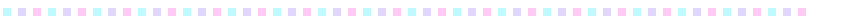
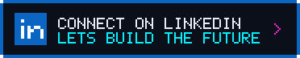

<div align="center">





</div>

## 👾 `whoami`

```yaml
name:      Vaios Pechlevanidis
mission:   "Wiederkehrende Arbeit an Maschinen abgeben – damit Menschen sich auf das Wesentliche konzentrieren können."
focus:
  - KI-Agenten & LLM-Anwendungen
  - Workflow-Automatisierung (APIs, Webhooks, Integrationen)
  - Prozessoptimierung & Datenpipelines
status:    🟢 offen für spannende Projekte & Kooperationen
```

<div align="center">




</div>

## 🧠 Woran ich arbeite

| 🤖 **Künstliche Intelligenz** | ⚙️ **Automatisierung** |
| :--- | :--- |
| KI-Agenten, die eigenständig Aufgaben erledigen | End-to-End-Workflows ohne manuelle Klicks |
| LLM-Integrationen & Prompt Engineering | API-Anbindungen, Webhooks & Datenpipelines |
| Chatbots & intelligente Assistenten | Trigger → Verarbeitung → Aktion – vollautomatisch |
| RAG, Embeddings & Wissensdatenbanken | Reporting, Benachrichtigungen & Monitoring |

## 🛠️ Tech Stack

<div align="center">


<br/><br/>


</div>

## 📊 GitHub Stats

<div align="center">


</div>

## 🤝 Let's connect

<div align="center">

<a href="https://www.linkedin.com/in/vaios-pechlevanidis-173ba0287/">
  
</a>

<br/><br/>

[](https://www.linkedin.com/in/vaios-pechlevanidis-173ba0287/)

<br/>




</div>

<!-- Die animierten Pixel-Art-SVGs werden mit `python3 scripts/generate_svgs.py` erzeugt. -->
